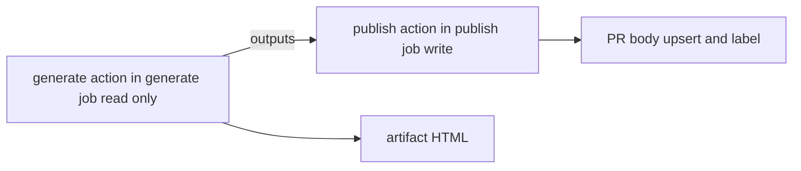

# pr-review-guide

PR ごとに「初見のレビュアー向け解説ページ（自己完結 HTML）」を Claude に生成させ、artifact の URL を PR 本文へ marker 方式で upsert する composite action のセットです。`aki77/skills` の `pr-review-guide` スキルで HTML を生成し、`/guide` PR コメントによる再生成と、`review-guide-done` ラベルによる二重生成の防止に対応しています。

元ワークフローは権限を分けるために 2 ジョブ構成（generate: 読み取り専用で Claude を実行、publish: 書き込み）です。Claude は PR 本文・コミットメッセージ・issue 本文という作成者が自由に書けるテキストを読むため、Claude を動かすジョブに書き込み権限を渡さないことが前提です。composite action は 1 ジョブ内でしか動かないため、ジョブごとに 1 つずつ、計 2 つの action に分かれています。



| action | 役割 |
|---|---|
| `pr-review-guide/generate` | PR の解決 → head SHA を checkout → スキルをインストール → Claude で HTML を生成 → 検証 → artifact としてアップロード |
| `pr-review-guide/publish` | `review-guide-done` ラベルを作成 → artifact の URL を PR 本文へ upsert → ラベルを付与 |

## 使用方法

トリガー（`on: pull_request` / `issue_comment`）と発火条件、runner・タイムアウト・権限・concurrency は呼び出し側のワークフローで定義します。

```yaml
name: PR Review Guide
on:
  pull_request:
    # WARNING: types に edited を入れてはいけない。publish が PR 本文を編集するため無限ループになる。
    #          labeled も同様（publish がラベルを付ける）。
    types: [opened, synchronize, ready_for_review]
  issue_comment:
    types: [created]

concurrency:
  # NOTE: PR更新時の生成と/guideコメントは同じgroupで同時実行を防ぐ (例: workflow--pr-123)
  # NOTE: 単なるコメントでもワークフロー自体は発動してしまうので、/guide以外のコメントは個別groupで無関係なキャンセルを防ぐ (例: workflow--comment-456)
  # NOTE: /guide の判定は generate ジョブの if と同じ startsWith にする（片方だけ contains だと PR 単位の同時実行制御が効かなくなる）
  group: |
    ${{
      github.event_name == 'pull_request' && format('{0}--pr-{1}', github.workflow, github.event.pull_request.number) ||
      startsWith(github.event.comment.body, '/guide') && format('{0}--pr-{1}', github.workflow, github.event.issue.number) ||
      format('{0}--comment-{1}', github.workflow, github.event.comment.id)
    }}
  cancel-in-progress: true

jobs:
  generate:
    # /guide コメント経路はラベルに関係なく常に許可する（手動再実行の入口）。
    # pull_request 経路は Dependabot・draft・`[skip guide]`・`review-guide-done` ラベル付きを除外する。
    # NOTE: /guide の判定に contains ではなく startsWith を使う。contains は部分一致なので
    #       本文中の URL（.../docs/guide/... など）や「userguide」といった語だけで誤発火し、
    #       無関係なコメントのたびに Claude の実行コストがかかる。
    # NOTE: リポジトリ固有の除外条件（特定ブランチ間の PR を除外するなど）はここの if に足す。
    if: |
      (
        github.event.issue.pull_request &&
        startsWith(github.event.comment.body, '/guide') &&
        contains(fromJSON('["OWNER", "MEMBER", "COLLABORATOR"]'), github.event.comment.author_association)
      ) ||
      (
        github.event_name == 'pull_request' &&
        github.actor != 'dependabot[bot]' &&
        !github.event.pull_request.draft &&
        !contains(github.event.pull_request.title, '[skip guide]') &&
        !contains(join(github.event.pull_request.labels.*.name, ','), 'review-guide-done')
      )
    runs-on: ubuntu-24.04-arm
    timeout-minutes: 30
    # WARNING: このジョブには書き込みスコープを一切与えない。composite action は permissions を
    #          持てないので、Claude を読み取り専用で動かす保証はこの permissions だけが担う。
    #          Claude が読むのは PR 作成者が自由に書けるテキストであり、プロンプトインジェクションに
    #          対する実効的な境界は --allowedTools の列挙ではなくトークンのスコープだけである。
    # NOTE: issues: read が必要なのは、明示的な permissions が「列挙しないスコープを none に
    #       する」ため。これが無いと PR 本文が issue にリンクしているときの gh issue view が
    #       private リポジトリで 403 になる。
    # WARNING: id-token: write を足してはいけない。他の Claude 系ワークフローの雛形を持ち込むと
    #          「読み取り専用」という前提が崩れる（action 内で github_token を明示しているのも
    #          OIDC トークンの交換経路に入らないため）。
    permissions:
      contents: read
      pull-requests: read
      issues: read
    # publish ジョブへ渡すため、action の outputs をジョブの outputs として再宣言する
    outputs:
      generated: ${{ steps.guide.outputs.generated }}
      artifact_url: ${{ steps.guide.outputs.artifact_url }}
      head_sha: ${{ steps.guide.outputs.head_sha }}
      pr_number: ${{ steps.guide.outputs.pr_number }}
      retention_days: ${{ steps.guide.outputs.retention_days }}
    steps:
      - name: Generate review guide
        id: guide
        uses: SonicGarden/composite-actions/pr-review-guide/generate@main
        with:
          # 以下どちらかが必須
          claude_code_oauth_token: ${{ secrets.CLAUDE_CODE_OAUTH_TOKEN }}
          anthropic_api_key: ${{ secrets.ANTHROPIC_API_KEY }}
          # artifact の保持日数（省略時 7）
          # retention_days: 7

  publish:
    needs: generate
    if: ${{ needs.generate.outputs.generated == 'true' }}
    runs-on: ubuntu-24.04-arm
    timeout-minutes: 5
    # NOTE: ラベル操作には issues: write が要る（ラベルは issues/PR 共通リソースで issues スコープで
    #       制御されるため、pull-requests: write だけでは 403 になる）。
    permissions:
      contents: read
      pull-requests: write
      issues: write
    steps:
      - name: Publish review guide
        uses: SonicGarden/composite-actions/pr-review-guide/publish@main
        with:
          pr_number: ${{ needs.generate.outputs.pr_number }}
          artifact_url: ${{ needs.generate.outputs.artifact_url }}
          head_sha: ${{ needs.generate.outputs.head_sha }}
          retention_days: ${{ needs.generate.outputs.retention_days }}
```

注意事項：

- checkout は generate の中で行います。呼び出し側で `actions/checkout` を前置しないでください（publish は checkout しません）
- checkout は PR の head SHA を `persist-credentials: false` で行い、トークンを `.git/config` に残しません
- generate ジョブの読み取り専用の保証は、呼び出し側ジョブの `permissions:` が担います（composite action は permissions を持てません）。`contents` / `pull-requests` / `issues` は `read` のみにし、`id-token: write` は付けないでください
- 認証情報が無い場合（fork の PR など）、generate は何もせず成功し、publish はスキップされます。生成に失敗した場合もラベルは付かないため、次の push で再挑戦されます
- トリガーの `types` に `edited` / `labeled` を入れないでください（publish が PR 本文とラベルを変更するため無限ループになります）
- `/guide` の判定は、generate ジョブの `if:` と `concurrency` の両方で `startsWith` を使い、そろえてください
- リポジトリ固有の除外条件が必要な場合は、generate ジョブの `if:` に条件を追加してください
- runner（`runs-on`）・タイムアウト（`timeout-minutes`）・権限（`permissions`）・`concurrency` は呼び出し側の job / ワークフローで指定します
- 呼び出し側で `gh actions-lock` を実行すると、アクション本体と内部で使用している actions を `actions.lock` で固定できます

## generate

### 入力パラメータ

- `claude_code_oauth_token` (どちらか必須): Claude Code OAuth トークン（推奨）
- `anthropic_api_key` (どちらか必須): Anthropic API キー（`claude_code_oauth_token` がない場合のフォールバック）
- `retention_days`: 生成した HTML artifact の保持日数（デフォルト: `7`）。リポジトリ / Organization の上限を超えるとアップロードが失敗します。PR 本文に表示する保持期間の文言も、この値を publish に渡して生成します

### 出力パラメータ

- `generated`: HTML が生成され、検証を通ったか（`true` / `false`。認証情報が無いときは `false`）
- `artifact_url`: アップロードした artifact の URL
- `head_sha`: 対象 PR の head SHA
- `pr_number`: 対象 PR の番号
- `retention_days`: artifact の保持日数

### 必要な権限

- `contents: read`
- `pull-requests: read`
- `issues: read`

## publish

### 入力パラメータ

すべて必須です。generate の同名の output を渡してください。空の場合は失敗します。

- `pr_number`: 対象 PR の番号
- `artifact_url`: artifact の URL
- `head_sha`: 対象 PR の head SHA
- `retention_days`: artifact の保持日数

### 出力パラメータ

なし

### 必要な権限

- `contents: read`
- `pull-requests: write`
- `issues: write`

## 機能

- `aki77/skills` の `pr-review-guide` スキルで、初見のレビュアー向け解説ページ（自己完結 HTML）を生成
- 生成した HTML を zip 化せず単一ファイルの artifact としてアップロードし、ブラウザでそのまま表示可能
- artifact の URL を PR 本文へ marker 方式で upsert（作者の文章はバイト単位で保持し、再実行しても重複しない）
- Claude を動かす generate ジョブは読み取り専用トークンで実行し、書き込みは Claude が動かない publish ジョブに隔離
- PR コメントで `/guide` と投稿すると再生成（OWNER / MEMBER / COLLABORATOR のみ）
- `review-guide-done` ラベルを自動作成・付与し、push での二重生成を防止
- ドラフト PR、`[skip guide]` を含むタイトル、Dependabot 起点の PR は自動的にスキップ

## SonicGarden/workflows の pr-review-guide.yml からの移行

主な変更点：

- `uses:` を job レベルから step レベルに移します。generate / publish の 2 ジョブを呼び出し側に書きます
- `runs_on` は廃止しました。各ジョブの `runs-on` で指定してください
- `secrets:` は `with:` に変わります。`claude_oauth_token` は `claude_code_oauth_token` に改名しました。`anthropic_api_key` も `with:` で渡します
- `permissions` は各ジョブに書きます。generate は read のみです（旧版のように呼び出し側の 1 ジョブへ write を付与する必要はありません）
- `claude_code_oauth_token` を指定した場合は `anthropic_api_key` を渡さなくなりました（旧版は OAuth トークンの有無にかかわらず API キーが渡されていました）
- checkout は PR の head SHA を `persist-credentials: false` で行います
