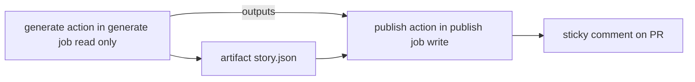

# pr-story

PR の差分を章立てした sticky コメントを Claude に生成させ、PR へ投稿・更新する composite action のセットです。`aki77/skills` の `pr-story` スキルでコメントを生成し、`/story` PR コメントによる再生成に対応しています。

Claude は PR 本文・コミットメッセージ・issue 本文という作成者が自由に書けるテキストを読むため、Claude を動かすジョブに書き込みトークンを渡さないことが前提です。そこで権限を分けるために 2 ジョブ構成（generate: 読み取り専用で Claude を実行して `story.json` だけを artifact にする、publish: Claude を動かさずに検証・render・投稿する）にしています。composite action は 1 ジョブ内でしか動かないため、ジョブごとに 1 つずつ、計 2 つの action に分かれています。



| action | 役割 |
|---|---|
| `pr-story/generate` | PR の解決 → head SHA を checkout → スキルをインストール → 差分が前回から変わったか確認 → Claude で `story.json` を生成 → 検証 → artifact としてアップロード |
| `pr-story/publish` | スキルをインストール → artifact の `story.json` をダウンロード → 検証・render → sticky コメントを投稿・更新 |

## 使用方法

トリガー（`on: pull_request` / `issue_comment`）と発火条件、runner・タイムアウト・権限・concurrency は呼び出し側のワークフローで定義します。

```yaml
name: PR Story
on:
  pull_request:
    # NOTE: edited は入れない。publish は PR 本文を編集しないのでループはしないが、
    #       本文を編集するたびに無駄に起動するため。
    types: [opened, synchronize, ready_for_review]
  issue_comment:
    types: [created]

concurrency:
  # NOTE: PR更新時の生成と/storyコメントは同じgroupで同時実行を防ぐ (例: workflow--pr-123)
  # NOTE: 単なるコメントでもワークフロー自体は発動してしまうので、/story以外のコメントは個別groupで無関係なキャンセルを防ぐ (例: workflow--comment-456)
  # NOTE: /story の判定は generate ジョブの if と同じ startsWith にする（片方だけ contains だと PR 単位の同時実行制御が効かなくなる）
  group: |
    ${{
      github.event_name == 'pull_request' && format('{0}--pr-{1}', github.workflow, github.event.pull_request.number) ||
      startsWith(github.event.comment.body, '/story') && format('{0}--pr-{1}', github.workflow, github.event.issue.number) ||
      format('{0}--comment-{1}', github.workflow, github.event.comment.id)
    }}
  cancel-in-progress: true

jobs:
  generate:
    # /story コメント経路は OWNER / MEMBER / COLLABORATOR のみ許可する（手動再生成の入口）。
    # pull_request 経路は Dependabot・draft・`[skip story]` を除外する。
    # NOTE: /story の判定に contains ではなく startsWith を使う。contains は部分一致なので
    #       本文中の URL や語だけで誤発火し、無関係なコメントのたびに Claude の実行コストがかかる。
    # NOTE: リポジトリ固有の除外条件（特定ブランチ間の PR を除外するなど）はここの if に足す。
    if: |
      (
        github.event.issue.pull_request &&
        startsWith(github.event.comment.body, '/story') &&
        contains(fromJSON('["OWNER", "MEMBER", "COLLABORATOR"]'), github.event.comment.author_association)
      ) ||
      (
        github.event_name == 'pull_request' &&
        github.actor != 'dependabot[bot]' &&
        !github.event.pull_request.draft &&
        !contains(github.event.pull_request.title, '[skip story]')
      )
    runs-on: ubuntu-24.04-arm
    timeout-minutes: 30
    # WARNING: このジョブには書き込みスコープを一切与えない。composite action は permissions を
    #          持てないので、Claude を読み取り専用で動かす保証はこの permissions だけが担う。
    #          Claude が読むのは PR 作成者が自由に書けるテキストであり、プロンプトインジェクションに
    #          対する実効的な境界は --allowedTools の列挙ではなくトークンのスコープだけである。
    # NOTE: issues: read が必要なのは、明示的な permissions が「列挙しないスコープを none に
    #       する」ため。これが無いと PR 本文が issue にリンクしているときの gh issue view が
    #       private リポジトリで 403 になる。
    # WARNING: id-token: write を足してはいけない。他の Claude 系ワークフローの雛形を持ち込むと
    #          「読み取り専用」という前提が崩れる（action 内で github_token を明示しているのも
    #          OIDC トークンの交換経路に入らないため）。
    permissions:
      contents: read
      pull-requests: read
      issues: read
    # publish ジョブへ渡すため、action の outputs をジョブの outputs として再宣言する
    outputs:
      generated: ${{ steps.story.outputs.generated }}
      pr_number: ${{ steps.story.outputs.pr_number }}
      head_sha: ${{ steps.story.outputs.head_sha }}
    steps:
      - name: Generate story
        id: story
        uses: SonicGarden/composite-actions/pr-story/generate@main
        with:
          # 以下どちらかが必須
          claude_code_oauth_token: ${{ secrets.CLAUDE_CODE_OAUTH_TOKEN }}
          anthropic_api_key: ${{ secrets.ANTHROPIC_API_KEY }}

  publish:
    needs: generate
    if: ${{ needs.generate.outputs.generated == 'true' }}
    runs-on: ubuntu-24.04-arm
    timeout-minutes: 5
    # NOTE: PR へのコメントの書き込みは pull-requests: write だけで足りる（ラベルは使わないので
    #       issues: write は不要）。このジョブでは Claude を動かさない。
    permissions:
      contents: read
      pull-requests: write
    steps:
      - name: Publish story
        uses: SonicGarden/composite-actions/pr-story/publish@main
        with:
          pr_number: ${{ needs.generate.outputs.pr_number }}
          head_sha: ${{ needs.generate.outputs.head_sha }}
```

注意事項：

- checkout は generate の中で行います。呼び出し側で `actions/checkout` を前置しないでください（publish は checkout しません）
- checkout は PR の head SHA を `persist-credentials: false` で行い、トークンを `.git/config` に残しません
- generate ジョブの読み取り専用の保証は、呼び出し側ジョブの `permissions:` が担います（composite action は permissions を持てません）。`contents` / `pull-requests` / `issues` は `read` のみにし、`id-token: write` は付けないでください
- 認証情報が無い場合（fork の PR など）、generate は何もせず成功し、publish はスキップされます。生成に失敗した場合も警告のみで成功し、次の push で再挑戦されます
- diff が前回の生成から変わっていない場合、`pull_request` 経路では Claude を起動せずに終了します。`/story` コメント経路は明示的な再生成依頼なので常に実行します
- generate と publish の `artifact` 名は `pr-story-<run_id>` で、同一ワークフロー run 内で受け渡します。artifact には `story.json` だけを入れ、publish 側で検証してから使います
- スキルの pin SHA は generate / publish の両方に書かれています。Dependabot の管理外なので手動で更新し、必ず両方を同期してください。更新時は `SKILL.md` の `allowed-tools` と generate の `--allowedTools` が一致しているか確認してください
- トリガーの `types` に `edited` は入れないでください（publish は PR 本文を編集しないのでループはしませんが、本文を編集するたびに無駄に起動します）
- `/story` の判定は、generate ジョブの `if:` と `concurrency` の両方で `startsWith` を使い、そろえてください
- リポジトリ固有の除外条件（`release-candidate` から `main` への PR を除外するなど）が必要な場合は、generate ジョブの `if:` に条件を追加してください
- runner（`runs-on`）・タイムアウト（`timeout-minutes`）・権限（`permissions`）・`concurrency` は呼び出し側の job / ワークフローで指定します
- 呼び出し側で `gh actions-lock` を実行すると、アクション本体と内部で使用している actions を `actions.lock` で固定できます

## generate

### 入力パラメータ

- `claude_code_oauth_token` (どちらか必須): Claude Code OAuth トークン（推奨）
- `anthropic_api_key` (どちらか必須): Anthropic API キー（`claude_code_oauth_token` がない場合のフォールバック）
- `model` (任意): Claude のモデル（既定: `sonnet`）

### 出力パラメータ

- `generated`: `story.json` が生成され、artifact にアップロードされたか（`true` / `false`。認証情報が無いときや、diff が前回から変わっていないときも `false`）
- `pr_number`: 対象 PR の番号
- `head_sha`: 対象 PR の head SHA

### 必要な権限

- `contents: read`
- `pull-requests: read`
- `issues: read`

## publish

### 入力パラメータ

すべて必須です。generate の同名の output を渡してください。空の場合は失敗します。

- `pr_number`: 対象 PR の番号
- `head_sha`: 対象 PR の head SHA

### 出力パラメータ

なし

### 必要な権限

- `contents: read`
- `pull-requests: write`

## 機能

- `aki77/skills` の `pr-story` スキルで、PR の差分を章立てした sticky コメントを生成・更新（再実行しても重複しない）
- Claude を動かす generate ジョブは読み取り専用トークンで実行し、書き込みは Claude が動かない publish ジョブに隔離
- Claude 由来の入力は検証を通る `story.json` だけで、diff・リンク・投稿先・Markdown は publish 側でスクリプトから作り直す
- diff が前回から変わっていなければ Claude を起動せずにスキップ
- PR コメントで `/story` と投稿すると再生成（OWNER / MEMBER / COLLABORATOR のみ）
- ドラフト PR、`[skip story]` を含むタイトル、Dependabot 起点の PR は自動的にスキップ
- generate の後に PR の head が動いた場合は、警告のみ出して投稿せず、新しい run に任せる

## pr-review-guide からの移行

`pr-story` は `pr-review-guide` の後継です。主な変更点：

- コマンドが `/guide` から `/story`、スキップ指定が `[skip guide]` から `[skip story]` に変わります
- `review-guide-done` ラベルによる二重生成の防止は不要です。ラベルの条件を generate ジョブの `if:` に書く必要はありません
- publish の `issues: write` は不要です（`contents: read` と `pull-requests: write` のみ）
- HTML artifact と PR 本文の upsert の代わりに、PR の sticky コメントを投稿・更新します
- 既存 PR の本文にある pr-review-guide のブロックは自動では削除されません。必要なら手動で取り除いてください
- artifact は `story.json` のみで保持日数も固定のため、`retention_days` の入力はありません
