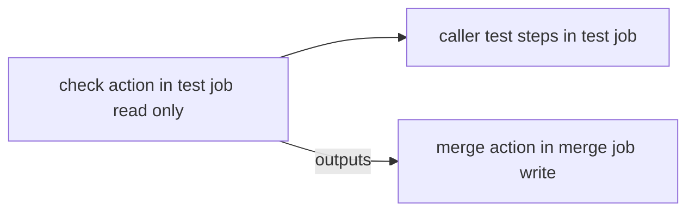

# update-ruby-version

Dependabot が更新できない `.ruby-version` を、最新の安定版 Ruby に自動で上げる composite action のセットです。最新の安定版（`x.y.z` 形式のみ。preview / rc は除外）を取得し、呼び出し側でテストを実行してから、PR を作成して squash マージします。

元ワークフローは権限を分けるために 2 ジョブ構成（test: `contents: read`、merge: 書き込み権限）です。composite action は 1 ジョブ内でしか動かないため、ジョブごとに 1 つずつ、計 2 つの action に分かれています。テスト手順（apt、setup-ruby、rspec など）はリポジトリごとに違うので呼び出し側に書きます。



| action | 役割 |
|---|---|
| `update-ruby-version/check` | checkout → 最新の安定版 Ruby を取得 → `.ruby-version` を書き換え → 差分の有無を判定 |
| `update-ruby-version/merge` | checkout → `.ruby-version` に version を書き込み → PR 作成 → `gh pr merge --squash --delete-branch` |

## 使用方法

```yaml
# Dependabot は .ruby-version を更新できないため、最新の安定版 Ruby への更新をこのワークフローで行う。
# GITHUB_TOKEN で作った PR では rspec.yml が起動しないので、テストもこのワークフロー内で実行してからマージする。
name: Update .ruby-version

on:
  schedule:
    - cron: "0 0 * * 1"
  workflow_dispatch:

permissions: {}

jobs:
  # gem のインストール・実行を伴うため、書き込み権限を持たせない
  test:
    runs-on: ubuntu-latest
    permissions:
      contents: read
    outputs:
      version: ${{ steps.check.outputs.version }}
      changed: ${{ steps.check.outputs.changed }}
    steps:
      - name: Check latest Ruby version
        id: check
        uses: SonicGarden/composite-actions/update-ruby-version/check@main

      - name: Install packages
        if: steps.check.outputs.changed == 'true'
        run: |
          sudo apt update -y
          sudo apt install -y libsqlite3-dev

      # ruby-version を省略して .ruby-version を読ませ、更新後のバージョンそのものでテストする
      - name: Set up Ruby
        if: steps.check.outputs.changed == 'true'
        uses: ruby/setup-ruby@v1
        with:
          bundler-cache: true

      - name: Run rspec
        if: steps.check.outputs.changed == 'true'
        run: bundle exec rspec

  merge:
    needs: test
    if: needs.test.outputs.changed == 'true'
    runs-on: ubuntu-latest
    permissions:
      contents: write
      pull-requests: write
    steps:
      - name: Create and merge pull request
        uses: SonicGarden/composite-actions/update-ruby-version/merge@main
        with:
          version: ${{ needs.test.outputs.version }}
```

注意事項：

- checkout は各 action の中で行います。呼び出し側で `actions/checkout` を前置しないでください
- merge ジョブの `if: needs.test.outputs.changed == 'true'` は呼び出し側に書きます（差分がなければ merge ジョブをスキップするため）
- `GITHUB_TOKEN` で作った PR ではほかのワークフローが起動しません。そのため、テストは test ジョブの中で実行してください
- リポジトリ設定で「Allow GitHub Actions to create and approve pull requests」を有効にしておく必要があります
- `GITHUB_TOKEN` で作った PR ではチェックが 1 つも走りません。base ブランチに required status checks があると `gh pr merge` が失敗します

## check

### 入力パラメータ

なし

### 出力パラメータ

- `version`: 取得した最新の安定版 Ruby のバージョン（`x.y.z` 形式）
- `changed`: `.ruby-version` に差分があるか（`true` / `false`）

### 必要な権限

- `contents: read`

## merge

### 入力パラメータ

- `version` (必須): 更新先の Ruby バージョン（`x.y.z` 形式。check の `version` output を渡す）。`x.y.z` 形式でなければ失敗します

### 出力パラメータ

なし

### 必要な権限

- `contents: write`
- `pull-requests: write`

## 備考

- PR のブランチ名（`update-ruby-version`）、タイトル、コミットメッセージ、本文は固定です
- `peter-evans/create-pull-request` は SHA で固定しています（`.github/dependabot.yml` で更新対象にしています）
